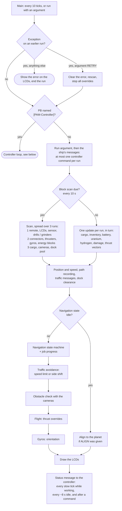
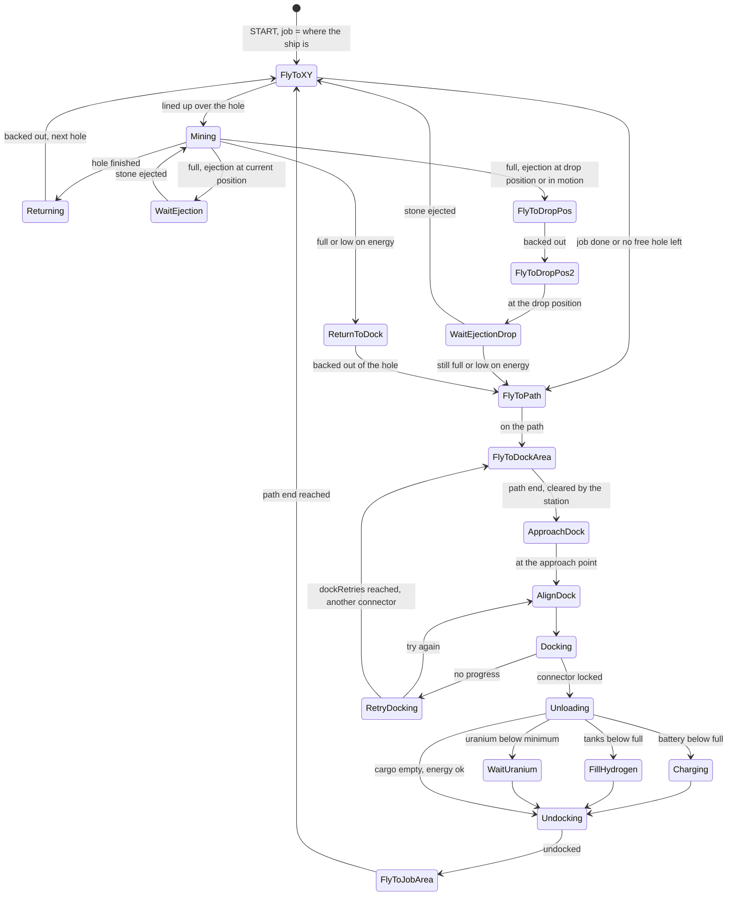
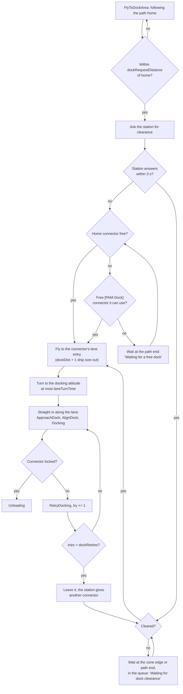
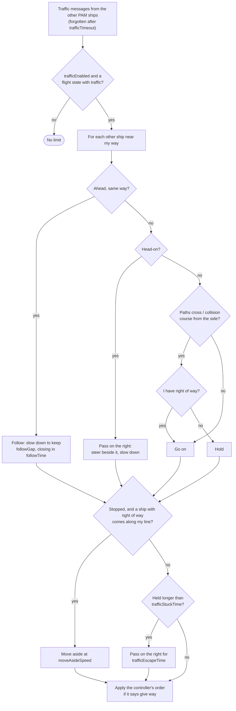
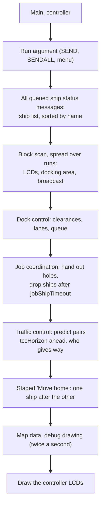

# PAM - Path Auto Miner (Deobfuscated)

Deobfuscated and modular source code for **[PAM] Path Auto Miner v1.3.1** by Keks.

The original script is published as a single minified/obfuscated file. This project restores it into readable, well-structured C# source files that can be modified, rebuilt, and re-minified for use in Space Engineers programmable blocks.

## Contents

- [Building](#building)
- [Which file to paste](#which-file-to-paste)
- [Setup in Space Engineers](#setup-in-space-engineers)
- [Run arguments](#run-arguments)
- [Configuration](#configuration): [menu](#menu-settings-job-and-behaviour), [Custom Data](#pb-custom-data), [settings reference](#settings-reference), [tuning tips](#tuning-tips)
- [How it works (flowcharts)](#how-it-works-flowcharts)
- [Multiple ships: obstacle brake, traffic and co-op mining](#multiple-ships-obstacle-brake-traffic-and-co-op-mining)
- [Controller screens](#controller-screens)
- [Changes from the original 1.3.1](#changes-from-the-original-131)

## Original Script

- **Author:** Keks
- **Steam Workshop:** https://steamcommunity.com/sharedfiles/filedetails/?id=1507646929
- **Guide:** https://steamcommunity.com/sharedfiles/filedetails/?id=1553126390

## Project Structure

```
├── src/                        # Deobfuscated source files (28 modules)
│   ├── 01_Constants.cs         # Constants, version, limits
│   ├── 02_Enums.cs             # All enum definitions
│   ├── 03_Types.cs             # Structs (WaypointInfo, ShipInfo, etc.)
│   ├── 04_Fields.cs            # Field declarations
│   ├── 05_Constructor.cs       # Program() constructor
│   ├── 06_Main.cs              # Main() entry point
│   ├── 07_ShipLoop.cs          # ShipMainLoop - tick processing
│   ├── 08_Commands.cs          # Argument/command processing
│   ├── 09_ShuttleConfig.cs     # Shuttle mode configuration
│   ├── 10_MenuNav.cs           # Menu navigation helpers
│   ├── 11_MenuBuilder.cs       # LCD menu screen builder
│   ├── 12_ConfigHelpers.cs     # Config value adjustment
│   ├── 13_PathRecording.cs     # Waypoint path recording
│   ├── 14_JobControl.cs        # Job start/stop/continue
│   ├── 15_Navigation.cs        # Navigation state machine
│   ├── 16_MiningProgress.cs    # Mining progress tracking
│   ├── 17_Resources.cs         # Battery, uranium, hydrogen
│   ├── 18_InventoryBalance.cs  # Inventory balancing across drills
│   ├── 19_Flight.cs            # Flight controller (UpdateFlight)
│   ├── 20_ThrustGyro.cs        # Thrust vectors, weight calc, gyro
│   ├── 21_NavTargets.cs        # Flight targets, alignment
│   ├── 22_BlockScan.cs         # Block scanning and filtering
│   ├── 23_MathAndSerial.cs     # Math utils, serialization
│   ├── 24_Persistence.cs       # Save/Load to Storage
│   ├── 25_Display.cs           # LCD display, error handling
│   ├── 26_Broadcast.cs         # IGC broadcast system
│   ├── 27_Controller.cs        # Controller mode (multi-ship)
│   ├── 28_UIHelpers.cs         # UI string formatting
│   ├── 29_ObstacleBrake.cs     # Camera raycast obstacle brake (new)
│   ├── 30_Traffic.cs           # Lanes, spacing, co-op mining (new)
│   ├── 31_DockPool.cs          # Ship-to-ship dock pool (new)
│   ├── 32_DockControl.cs       # Station dock control, controller side (new)
│   ├── 33_DockClearance.cs     # Dock clearance, ship side (new)
│   ├── 34_JobCoordinator.cs    # Controller: co-op job record, hole assignment (new)
│   ├── 35_TrafficControl.cs    # Controller: traffic control, staged "Move home" (new)
│   ├── 36_DebugDraw.cs         # Controller: 3D debug drawing via the DebugAPI mod (new)
│   └── 37_Settings.cs          # Settings in the PB's Custom Data (new)
├── tools/
│   ├── build_pam.py            # Combines src/, minifies, writes the ship/controller scripts
│   ├── minify_pam.py           # Minifies into SE-ready script
│   ├── strip_unused.py         # Makes the ship-only / controller-only variants
│   └── validate_minified.py    # Sanity checks + 100,000-char limit
├── PAM_ORIGINAL.cs             # Original obfuscated script (reference)
├── PAM_Combined.cs             # Build output (combined from src/)
├── PAM_Ship.cs                 # Paste into miner / grinder / shuttle PBs
├── PAM_Controller.cs           # Paste into the [PAM-Controller] PB
└── PAM_Minified.cs             # Both modes in one script (only while it fits)
```

## Requirements

- Python 3.8+

## Building

**Step 1: Combine** source files into a single file:

```bash
python tools/build_pam.py
```

This reads all `src/*.cs` files (sorted by numeric prefix) and outputs `PAM_Combined.cs`.

**Step 2: Minify** for Space Engineers:

```bash
python tools/minify_pam.py PAM_Combined.cs --output PAM_Minified.cs --map tools/identifier_map.txt
```

This renames identifiers to short Unicode names, strips whitespace/comments, and produces a script that fits within SE's programmable block limits.

**One-step build + minify:**

```bash
python tools/build_pam.py --minify
```

This writes `PAM_Combined.cs`, `PAM_Minified.cs`, `PAM_Ship.cs` and `PAM_Controller.cs`, and reports how many characters each script has left under the limit.

## Which file to paste

The programmable block limit is 100,000 characters, and one script with both the ship logic and the controller logic no longer leaves room for new features. So the build writes two scripts:

- **`PAM_Ship.cs`** for miners, grinders and shuttles
- **`PAM_Controller.cs`** for the `[PAM-Controller]` PB

Pasting the wrong one is harmless: the PB just says which file it needs. `PAM_Minified.cs` (both modes in one script) no longer fits under the limit and is only kept as a build check.

## Setup in Space Engineers

### 1. Paste the script

1. Build the project (see above), or use the `PAM_Ship.cs` / `PAM_Controller.cs` already in the repository.
2. Open the file for the PB you are setting up (see [Which file to paste](#which-file-to-paste)) and copy all of it.
3. In the game, open the programmable block, **Edit**, paste, **Check code**, then close the editor and keep the code.
4. The script runs itself every 10 game ticks (6 times a second). It needs no timer block.

On the first run the script fills the PB's Custom Data (see [Configuration](#configuration)) and decides the ship's mode:

- PB name contains `[PAM-Controller]` → **controller** (station).
- Otherwise drills on the grid → **miner**, grinders → **grinder**, neither → **shuttle**.

### 2. Blocks on a ship

Only blocks on the PB's own grid count, except cameras: those on subgrids (rotors, pistons) work too. When the ship has several blocks of one kind, tag the ones PAM should use with `[PAM]` in the name. Then only the tagged ones are used.

| Block | Needed | Notes |
|---|---|---|
| Programmable block | yes | Runs `PAM_Ship.cs`. Its Custom Data holds the broadcast settings and the `[PAM settings]` section. |
| Remote control | yes | The drills/grinders must point the way the remote faces (forward) or its down side, otherwise "Wrong remote direction". Several remotes: tag one `[PAM]`. |
| Drills (miner) / grinders (grinder) | yes | All must face the same way. If some face another way, tag the ones that set the mining direction with `[PAM]`, otherwise "Mining direction is unclear!". |
| Sensor | grinder only | Tagged `[PAM]`. It must face the same way as the grinders, with its top side the way the remote faces or its bottom side the remote's bottom side ("Wrong sensor direction"). |
| Connector | yes | The ship's docking connector: the normal connector, not the small one. Several: tag one `[PAM]`. |
| Gyroscopes, thrusters | yes | "Gyros are missing" / "Thrusters are missing". |
| Batteries, hydrogen tanks, reactors | for the energy limits | Tag with `[PAM]` to use only those batteries / tanks. |
| Cargo containers | for cargo | The drill/grinder inventories and connectors that aren't set to Throw Out also count as cargo. |
| Antenna | for several ships | Broadcasting on and the antenna on. Needed for traffic, co-op mining, station dock control and the controller. |
| Cameras | for the obstacle brake | Every working camera of the ship is used. Face them the ways the ship flies (forward, plus sideways / up / down for the moves between holes). |
| Landing gears | for emergency landing | The script switches their auto lock off. Tag `[PAM]` to choose which. |
| Sorters | for ejection | With **Toggle sorters** on, switched on to eject stone (and ice) and off while mining. Tag `[PAM]` to choose which. |
| LCD panels | optional | `[PAM]` in the name shows the menu / status. On a cockpit or other block with screens, `[PAM:n]` uses its screen n (1 = first). |
| Timer blocks | shuttle only | Chosen in the shuttle menu, triggered on docking / before leaving. |

A missing remote, a wrong remote direction or an unclear mining direction stops the ship. The other problems are shown as a status message and keep the job from starting ("Setup error! Can't start").

### 3. Record the path and home

1. Dock the ship at its home connector.
2. Run `PATHHOME` (or menu **Record path & set home**). The home dock is taken from the connector the ship stands at (locked or ready to lock).
3. Fly to the job site by hand. A waypoint is recorded every 2 m or more (more spacing at higher speed). Fly the way you want the ship to fly: it follows this path out and back.
4. Stop the recording on the menu (**Stop path recording**). On the recording page you can keep the old home or the old path instead of the new one.

`PATH` records a new path and keeps the old home. A **shuttle** records from connector 1 to connector 2: the first connector it stands at is connector 1, one more than 5 m away is connector 2.

### 4. Set up and start the job

1. Fly to where the job starts and turn the ship so the drills point into the rock (for a grinder: into the target). The job position and direction are the ship's position and orientation when you start the job.
2. Menu **Setup mining job** (or `CFGS width height depth`): set the job size, depth mode and start position, see [Menu settings](#menu-settings-job-and-behaviour).
3. **Start new job!** (or `START`). The ship mines the holes one after the other, flies home when it's full or low on energy, unloads, charges / refuels if needed and flies back.
4. **Behavior settings** set when it goes home, what it does when the job is done or damaged, ejection and speeds.

`STOP` stops everything, `CONT` continues a stopped job from where the ship is.

### 5. Station and controller (optional)

For a busy base, or to see and command all ships from one place:

1. Put a PB on the station, name it with `[PAM-Controller]` (e.g. `PB [PAM-Controller]`) and paste `PAM_Controller.cs`. Add an antenna with broadcasting on.
2. LCDs on the station with `[PAM]` in the name show the controller screens. The LCD's Custom Data sets what it shows (`mode=...`, see [Controller screens](#controller-screens)).
3. Station connectors the ships may use besides their home: add `[PAM-Dock]` to their names (dock pool).
4. Optional: a sensor named `[PAM-Zone]` sized to the docking area, and a camera named `[PAM-Lane]` within 10 m of each connector, facing out along the approach.
5. For the ship list, ship menus and commands: on every ship set `Enable_Broadcast=true`, a `Ship_Name` and the same `Broadcast_Channel` as the controller (in the PB's Custom Data, then Recompile).

Traffic, station dock control and co-op mining use their own messages: they need only the antennas, not `Enable_Broadcast`.

### 6. Several ships on one job (co-op)

1. Set up the job on one ship and run `EXPORT` (copies path, home, job and settings to the Custom Data of a block named `[PAM-Data]`).
2. On each other ship run `IMPORT JOB` (only the job; the ship keeps its own path and home) and then `CONT`.
3. All ships need the same drill layout. With a controller in range, the controller hands out the holes.

### Multiplayer / dedicated server

The scripts run on the server like any PB script. Each PB's run time is shown in its output and on the controller (see [Controller screens](#controller-screens)); on a server with a PB time limit keep the average well under it. `debugDraw` needs a debug draw mod and is for testing (see [Changes](#changes-from-the-original-131)).

## Modifications

Edit files in `src/` and rebuild. The modular structure makes it easy to find and modify specific systems:

- **Mining behavior:** `15_Navigation.cs` (Mining state)
- **Flight control:** `19_Flight.cs`, `20_ThrustGyro.cs`
- **Settings:** defaults in `01_Constants.cs`, read from Custom Data in `37_Settings.cs`
- **Menu/UI:** `11_MenuBuilder.cs`
- **Save/Load format:** `24_Persistence.cs`

**Check the result** (balanced braces, required identifiers, 100,000-character limit; exits non-zero on problems):

```bash
python tools/validate_minified.py PAM_Minified.cs
```

The minifier only renames identifiers the script itself declares, so game/.NET API names are never renamed, and its output is identical on every run.

To save space it also replaces often-used literals and API calls with short aliases declared at the top of the minified code (`true`/`false`, the connector status values, and small static helpers with the same parameter types for `Vector3.Distance`, `Vector3.Dot`, `Vector3.Normalize`, `Math.Round` and `GridTerminalSystem.GetBlocksOfType`), each only when it saves characters, and writes numbers short (`0.5f` → `.5f`, `2.0f` → `2f`). String literals (menu and status texts) are never changed.

## Run arguments

Type them without the brackets:

| Argument | What it does |
|---|---|
| `UP` / `DOWN` / `APPLY` | Menu navigation up / down, apply menu point |
| `UPLOOP` / `DOWNLOOP` | Up / down with looping |
| `PATHHOME` | Record path, set home |
| `PATH` | Record path, use old home |
| `START` / `STOP` / `CONT` | Start job / stop every process / continue the job (paused, changed, or active: re-plans from where the ship is; near home but not at the connector: docks first) |
| `JOBPOS` / `HOMEPOS` | Move to job position / home position |
| `FULL` | Simulate ship is full |
| `ALIGN` | Align the ship to the planet |
| `RESET` | Reset all data |
| `EXPORT` / `IMPORT` / `IMPORT JOB` | Save path + job to the data block / load path + job / load only the job (co-op) |
| `SHUTTLE` | Enable shuttle mode (miner) |
| `UNDOCK` | Leave the current connector (shuttle) |
| `NEXT` / `PREV` | Next / previous hole (co-op: `PREV` reopens that hole for the controller and the other ships too) |
| `CFGS width height depth` | Job size, e.g. `CFGS 5 3 20` |
| `CFGB done damage` | When done: `HOME`, `STOP`; on damage: `HOME`, `JOB`, `STOP`, `IG`. E.g. `CFGB HOME IG` |
| `CFGL maxload weightLimit` | Max load `10..95`, weight limit `On`/`Off`. E.g. `CFGL 70 on` |
| `CFGE minUr minBat minHyd` | Minimum uranium `1..25`, battery `5..30`, hydrogen `10..90`, or `IG` to ignore. E.g. `CFGE 20 10 IG` |
| `CFGW forward backward` | Work speed `0.5..10` each. E.g. `CFGW 1.5 2` |
| `CFGA acceleration` | Acceleration `10..100`. E.g. `CFGA 80` |

## Configuration

PAM is configured in four places:

| Where | What | How to change |
|---|---|---|
| PAM menu on the `[PAM]` LCD | The job (size, depth, start position) and the ship's behaviour (load, energy limits, ejection, speeds) | Run arguments `UP` / `DOWN` / `APPLY`, or the `CFG...` arguments. Saved with the ship's PB. |
| PB Custom Data, broadcast part | Controller link: on/off, ship name, channel | Edit, then **Recompile** |
| PB Custom Data, `[PAM settings]` | Tags, speeds, distances, traffic and timing | Edit, then **Recompile** |
| LCD Custom Data (controller) | What each controller LCD shows, font and size | Edit; read on the next update. See [Controller screens](#controller-screens). |

### Menu settings (job and behaviour)

**Job setup** (miner / grinder, before **Start new job!**). **Change current job** applies new values to the running job.

| Menu line | Default | Values | Meaning |
|---|---|---|---|
| Width | 3 | 1 and up (steps of 1 to 20, then larger) | Holes across. The menu shows the width in metres (holes × drill area width). |
| Height | 3 | 1 and up (steps of 1 to 20, then larger) | Holes up/down. Shown in metres too. |
| Depth | 30 m | 0 and up (steps of 2 to 50, then larger) | Hole depth. In an Auto depth mode it's the minimum depth. |
| Depth mode | Default | Default, Auto (Ore), Auto (+Stone) | **Default:** every hole to Depth. **Auto (Ore):** at least Depth, then deeper while the drills still collect ore other than stone; the hole ends when nothing new came in for a while. **Auto (+Stone):** the same, stone counts too (miners only). |
| Start pos | Top-Left | Top-Left, Center | Where the hole pattern starts. |

**Behavior settings** (miner / grinder)

| Menu line | Default | Values | Meaning |
|---|---|---|---|
| Max load | 90 % | 10–95 % | Cargo fill at which the ship counts as full. |
| Weight limit | On | On / Off | Also full when the ship gets too heavy to fly with `minAccelerationSmall` / `Large`. |
| Ejection | Off | Off, Cur. pos, Drop pos, In motion; each for Stone or Stone + Ice | When full, eject stone (and ice) and keep mining instead of flying home. **Cur. pos:** stops in the hole and ejects there. **Drop pos:** backs out and ejects over a diagonal neighbour hole (on a planet, mining roughly downwards, job at least 2 × 2), otherwise where it is. **In motion:** backs out and circles slowly over the hole while ejecting. Not for grinders. |
| Toggle sorters | Off | On / Off | On: PAM switches the sorters on to eject and off while mining. |
| Unload ice | On | On / Off | Off: the ship doesn't wait for its ice to be unloaded at the base (it keeps it on board). |
| Uranium | Min 5 kg | Ignore, 1–25 kg | Fly home below this. |
| Battery | Min 20 % | Ignore, 5–30 % | Fly home below this; charges to full when docked. |
| Hydrogen | Min 20 % | Ignore, 10–90 % | Fly home below this; fills up when docked. |
| When done | Return home | Return home / Stop | After the last hole. |
| On damage | Return home | Return home, Fly to job pos, Stop, Ignore | When the ship is damaged. |

**Advanced** (from Behavior settings)

| Menu line | Default | Values | Meaning |
|---|---|---|---|
| Drill / Grinder inv. balancing | On | On / Off | Spread the cargo across the drills/grinders. |
| Enable drills | Fwd + Bwd | Fwd + Bwd / Fwd | Drills on while backing out of a hole too, or only going in. |
| Work speed fwd. / bwd. | 1.5 / 2.5 m/s | 0.5–10 m/s | Speed going into / out of a hole. |
| Acceleration | 70 % | 10–100 % | Share of the thrust used. Above 80 % the menu shows "(risky)". |
| Width / Height overlap | 0 % | 0–75 % | Overlap between neighbouring holes. Changing it sets the hole spacing again. |

**Shuttle**: undock trigger at each connector (on "Undock" command, player entered cockpit, time delay, ship full / empty, batteries full / below 25 % / empty, hydrogen full / below 25 % / empty), the delay for the time trigger, and a timer block to trigger on docking and before leaving at each connector. Shuttle behaviour has Max load, Unload ice, Uranium, Battery (Ignore / Charge up), Hydrogen (Ignore / Fill up), On damage and Acceleration.

The same values can be set with run arguments (`CFGS`, `CFGB`, `CFGL`, `CFGE`, `CFGW`, `CFGA`, see [Run arguments](#run-arguments)).

### PB Custom Data

The script writes the Custom Data the first time it runs. A ship's looks like this (the controller's has `[PAM-Controller]` in the first line, `Enable_Broadcast=true` and no `Ship_Name`):

```
[PAM-Ship] Broadcast-settings

Enable_Broadcast=false
Ship_Name=Your_ship_name_here
Broadcast_Channel=#default

[PAM settings] edit, then Recompile. Delete a line to get its default. See README.
pamTag=[PAM]
controllerTag=[PAM-Controller]
dataTag=[PAM-Data]
dockPoolTag=[PAM-Dock]
dockDist=0.6
drillRadius=1.4
minAccelerationSmall=0.2
minAccelerationLarge=0.1
setLCDFontAndSize=true
trafficEnabled=true
debugDraw=false
dockRequestDistance=300
gyroSpeedSmall=15
...
```

**Broadcast part** (the original PAM controller link)

| Line | Default | Meaning |
|---|---|---|
| first line | `[PAM-Ship] Broadcast-settings` | Must stay as it is. If it doesn't match, the script writes this part again with the defaults ("Reset custom data"). |
| `Enable_Broadcast` | `false` (ship), `true` (controller) | `true` sends the ship's status to the controller and takes its commands. |
| `Ship_Name` | `Your_ship_name_here` | Name on the controller. |
| `Broadcast_Channel` | `#default` | Ships and controller must use the same channel. |

**`[PAM settings]` section**

- Change a value after the `=`, then press **Recompile**. The values are read only when the script starts.
- Delete a line to get its default back. Lines the script doesn't know are dropped.
- New versions add their new settings by themselves. Pasting a new script keeps your values.
- Each script lists only the settings it uses: the ship script doesn't list controller settings and the other way round.
- Write numbers the way the script wrote the defaults. `true` / `false` for switches.
- A value that can't be read keeps its default, and the PB shows "Bad setting, default used: <name>".
- "x ship size" means the setting is multiplied by the ship's size: the diameter of its grid's bounding sphere.

### Settings reference

The **Script** column says which script lists the setting: ship (`PAM_Ship.cs`), controller (`PAM_Controller.cs`) or both.

#### Tags

| Setting | Default | Script | Meaning |
|---|---|---|---|
| `pamTag` | `[PAM]` | both | Tag of the blocks PAM uses: LCDs (`[PAM:<n>]` for screen n of a block, e.g. `[PAM:1]`), and the remote, connector, drills, sensor, sorters, landing gears, batteries and tanks to use when there are several. On the controller: its LCDs. |
| `controllerTag` | `[PAM-Controller]` | both | A PB with this in its name is the controller. |
| `dataTag` | `[PAM-Data]` | both | Block whose Custom Data `EXPORT` / `IMPORT` use. |
| `dockPoolTag` | `[PAM-Dock]` | both | Station connectors ships may use when their home dock is taken. |
| `zoneTag` | `[PAM-Zone]` | controller | Sensor over the docking area: nobody is cleared while another ship moves in it. |
| `laneTag` | `[PAM-Lane]` | controller | Camera at a connector (within 10 m), facing out along its approach: the lane must be clear. |

Tags are matched anywhere in the block name, upper/lower case doesn't matter. If you change a tag, rename the blocks and change it on every ship and the controller the same way.

#### Speeds and flight

| Setting | Default | Script | Meaning |
|---|---|---|---|
| `generalSpeedLimit` | 100 | ship | [m/s] top speed. 0 = no limit. Whole numbers. |
| `jobAreaSpeed` | 10 | ship | [m/s] near the job area: between holes, backing out, arriving, leaving. |
| `dockAreaSpeed` | 5 | ship | [m/s] in the docking area: inside the `[PAM-Zone]` area, from the path end to the connector, aligning, undocking. |
| `dockingSpeed` | 0.5 | ship | [m/s] final approach to the connector. |
| `gyroSpeedSmall` / `gyroSpeedLarge` | 15 / 5 | ship | [RPM] gyro speed of small / large ships. Whole numbers. |
| `minAccelerationSmall` / `minAccelerationLarge` | 0.2 / 0.1 | both | [m/s²] minimum acceleration in space; below it the ship counts as too heavy (Weight limit). |
| `emergencySpeed` | 3 | ship | [m/s] descent speed of an emergency landing in gravity. |
| `moveAsideSpeed` | 2 | ship | [m/s] speed while moving aside for a PAM ship coming along its line. |

#### Path, job and dock geometry

| Setting | Default | Script | Meaning |
|---|---|---|---|
| `dockDist` | 0.6 | both | x ship size: approach point in front of the connector. The lane entry is one ship size further out. |
| `followPathDock` / `followPathJob` | 2 / 1 | ship | x ship size: stop following the path this close to the dock / job and fly straight there. |
| `useDockDirectionDist` / `useJobDirectionDist` | 1 / 0 | ship | x ship size: this close to the dock / job, turn to the dock's / job's orientation instead of the waypoint's. |
| `wpReachedDist` | 2 | ship | [m] a waypoint counts as reached this close. |
| `drillRadius` | 1.4 | both | [m] cut radius of grinders and modded drills. Vanilla drills use their real radius (small 1.3 m, large 1.9 m, large Prototech 6 m). |
| `coopWaitHeight` | 2.5 | ship | x ship size: height of the ring above the job centre where co-op ships wait for a hole. |
| `holeStuckTime` | 5 | ship | [s] no progress on the way down to a hole for this long (not held by traffic or the cameras): over the hole the ship starts the hole where it is, anywhere else it goes over the hill, one ship size higher. |
| `laneTurnTime` | 8 | ship | [s] at most this long turning to the docking attitude at the lane entry, then on anyway (weak gyros, heavy cargo). |
| `dockRetries` | 3 | ship | Connector didn't lock this many times: leave it and ask for another one. Not for shuttles. At least 1. |

#### Grinder

| Setting | Default | Script | Meaning |
|---|---|---|---|
| `sensorRange` | 2 | ship | x ship size: fly slowly while the sensor finds blocks this close. |
| `fastSpeed` | 10 | ship | [m/s] speed while the sensor finds no blocks. |

#### Cargo

| Setting | Default | Script | Meaning |
|---|---|---|---|
| `minEjection` | 25 | ship | [%] if one ejection removes less than this share of the ore, the ship flies home instead of mining on. |

#### Obstacle brake (cameras)

| Setting | Default | Script | Meaning |
|---|---|---|---|
| `obstacleBrake` | true | ship | Camera obstacle brake on / off. Off: the cameras aren't used. |
| `obstacleLookAhead` | 3 | ship | [s] scan distance = speed × this + ship size. Larger: brakes earlier, uses more camera charge. |
| `obstacleTimeout` | 10 | ship | [s] after holding this long the ship shows "Path blocked: <type>" (also on the controller). |

#### Traffic between PAM ships

| Setting | Default | Script | Meaning |
|---|---|---|---|
| `trafficEnabled` | true | both | Traffic between PAM ships: lanes, spacing, right of way, co-op holes. |
| `laneOffset` | 0.75 | ship | x ship size: keep right of the recorded path. 0 = fly on the path. |
| `followGap` | 1 | ship | x ship size: free space kept behind a PAM ship ahead. |
| `followTime` | 2 | ship | [s] time to close the gap to a PAM ship ahead. Lower: follows closer, brakes later. At least 0.1. |
| `trafficHullCover` | true | ship | Traffic size covers the whole hull. The ship's position is its centre of mass, its size the grid's bounding sphere around the middle of the grid, so on a lopsided ship the offset between the two is added. Other ships, the controller and the debug sphere use this size. |
| `trafficPadding` | 0 | ship | [m] extra space kept around the ship for traffic, on every side. |
| `trafficStuckTime` / `trafficEscapeTime` | 15 / 10 | ship | [s] held by traffic this long, the ship stops waiting and passes on the right for this long. It still stops for a ship less than 2 s away. |
| `trafficTimeout` | 5 | ship | [s] forget a PAM ship not heard from for this long (a stopped ship: at least 12 s). |

#### Station dock control

| Setting | Default | Script | Meaning |
|---|---|---|---|
| `dockRequestDistance` | 300 | ship | [m] ships ask the station for clearance this close to home, then wait outside the zone. |
| `dockLaneLength` | 40 | controller | [m] how far the `[PAM-Lane]` cameras check. |
| `clearanceTimeout` | 120 | controller | [s] a ship cleared to dock that hasn't docked or left by then loses its clearance and goes to the back of the queue. |
| `laneClearTime` | 3 | controller | [s] a lane camera has seen nothing for this long: the connector is usable again. |

#### Controller

| Setting | Default | Script | Meaning |
|---|---|---|---|
| `tccHorizon` | 8 | controller | [s] how far ahead the controller predicts conflicts between ships. Larger: slows ships earlier. |
| `jobShipTimeout` | 600 | controller | [s] a co-op ship not heard from for this long loses its hole. |
| `lcdLineHeight` | 30 | controller | Pixels per text line at font size 1.0 (512 px LCD). Sets how many lines the main / paged screens fit for each LCD's font size. Bottom line cut off: raise it; a spare line at the bottom: lower it. |

#### Other

| Setting | Default | Script | Meaning |
|---|---|---|---|
| `setLCDFontAndSize` | true | both | Set font and size of an LCD once, when the script first finds it. Change them afterwards as you like. |
| `resumeAfterRestart` | true | ship | Continue a running job after a server restart / world load. `false`: stay paused like the original. |
| `debugDraw` | false | both | 3D debug drawing (needs a debug draw mod, see [Changes](#changes-from-the-original-131)). |

### Tuning tips

- **Ships too close / too far apart:** `followGap` and `followTime` (behind each other), `laneOffset` (side by side on the path), `trafficPadding` (all around).
- **Debug sphere off-centre on a lopsided ship:** keep `trafficHullCover=true`, add `trafficPadding` if parts still stick out.
- **Ships wait too long for each other:** lower `trafficStuckTime`. **Ships give way too late:** raise `tccHorizon` on the controller.
- **Docking:** `dockingSpeed` (final approach), `dockDist` (approach point), `laneTurnTime` (turning at the lane), `dockRetries` (tries before another connector).
- **Ship stuck on terrain over a hole:** lower `holeStuckTime`.
- **Ship flies home before it is full ("too heavy"):** lower `minAccelerationSmall` / `minAccelerationLarge`, or turn Weight limit off in the menu.

## How it works (flowcharts)

The diagrams use [Mermaid](https://mermaid.js.org/), which GitHub draws on its own. The state names are the `NavState` values in `src/02_Enums.cs`; the menu shows them as text ("Flying to job area", ...).

### One run of the ship script

`Main` runs every 10 game ticks (`Update10`) and when the PB is run with an argument. A "slow tick" is every 10th run (about every 1.7 s).



While the ship is idle, the scan and the updates run only on slow ticks, to keep the run time low.

### Miner / grinder job cycle



- **FlyToXY:** picks the next hole (co-op: one no other ship has), flies over it at least one ship size above the job surface, then straight down. The drills are off on the way.
- **Mining:** drills on, down at the work speed to the depth (Auto depth: deeper while ore still comes in). If the ship gets stuck it backs up about one ship size and tries again ("Ship stuck! Retrying").
- **Returning / ReturnToDock:** backs out to one ship size above the job surface, clear of the ships working there.
- **Unloading:** waits until the cargo is empty (Unload ice off: ice may stay), then charges / refuels to full if a limit is set, then undocks.
- A job set to **When done: Stop**, or a ship without home, flies to the job position instead of home when the job is done.
- Emergency landing, moving aside and the camera brake act inside these states and don't change them.

### Docking with a station (`[PAM-Controller]`)



Station side, every run: one ship at a time is cleared to move in the docking area (emergencies first; ships waiting to undock go first once no ship is docking). A ship on its last leg (turned in its lane, aligning, docking) keeps its clearance and the next ship may come in. The station checks each target connector's lane camera; something in the lane takes the clearance away until the lane has been clear for `laneClearTime`. A cleared ship that hasn't finished after `clearanceTimeout` goes to the back of the queue.

### Traffic decision (each run, per ship, simplified)



The sizes in all checks are the traffic sizes (`trafficHullCover`, `trafficPadding`). While docking, undocking or backing out of a hole the ship only slows down and holds: no stepping aside, no escape. The details and the right-of-way order are in [Multiple ships](#multiple-ships-obstacle-brake-traffic-and-co-op-mining).

### One run of the controller script



## Multiple ships: obstacle brake, traffic and co-op mining

All three are on by default and can be turned off in the settings (see [Settings reference](#settings-reference)).

- **Docking approach:** the camera sweep also runs on the way from the path end to the connector. Anything right at the approach point (the station around the connector) doesn't count. Blocked there for 4 s, the ship tries to go around: one ship size up, right, left and down from the straight line, one after the other, and from the point beside the obstacle straight to the connector again. If none works it stays where it is ("Docking blocked: <type>, stopped").
- **Obstacle brake:** the ship uses its own camera blocks to raycast where it's flying (its velocity once it moves, otherwise towards its flight target), and holds position while something is in the way. Each run casts one ray along the centre of the flight line and one to the next of 8 edge points: the four edges of the ship at the scan distance and at half of it, so blocks only the ship's edge would clip are found too. The edge points are at the ship's real outline (its grid box) in that direction, not its bounding sphere, which is much wider than a long ship. Each ray comes from the camera that faces that point best and has charge left. The edge rays look for blocks only; terrain is checked on the centre line, so low paths don't trigger it. A full sweep without a hit releases the hold. Hits on the ship's own subgrids (rotors, pistons) are ignored. The cameras also run while backing out of a hole and undocking (blocks only). PAM ships are left to the traffic rules, except one right in front (centre ray, closer than one ship size): then the ship brakes whatever the traffic rules say. A PAM ship parked at a connector is an obstacle for the cameras (the traffic rules leave it out), except while flying straight into or backing out of the own connector's lane, right beside the ships docked next to it. The info page lists which ship directions the cameras cover; if no camera can look where the ship is going for 2 s, it says "Cameras can't see ahead". It's active during path flights and hole-to-hole moves, and off while mining, backing out of a hole and docking. A camera only scans within 45° of where it faces, so put cameras facing each direction the ship travels: forward, and sideways or up and down for the moves between holes. After `obstacleTimeout` seconds the ship shows "Path blocked: <type>" (also on the controller). Terrain (planet, asteroid) doesn't count on moves between holes (the hole tops sit on the ground), or right at the flight target.
- **Traffic:** PAM ships send a short traffic message about twice a second. This needs a working antenna and is independent of `Broadcast_Channel`. On the recorded path, ships keep right by `laneOffset` × ship size, merging back onto the path near the dock and the job. Ships going opposite ways therefore pass side by side, and a ship meeting another head-on steers to a point beside it, where they meet (not to its far flight target with an offset, which would hardly move it sideways in time), and slows down until it is beside it. A ship slows down or holds behind a PAM ship ahead, keeping `followGap` × ship size of free space. Ships also send the direction they're heading, so ships meeting head-on pass each other even when both have slowed down or stopped. When two ships' paths cross and each has the other ahead, the one with right of way goes first (see below). A ship held by traffic for `trafficStuckTime` (15 s) stops waiting for `trafficEscapeTime` (10 s) and passes on the right ("Traffic: passing a stuck ship"); it still stops for a ship less than 2 s away. Avoidance also runs while docking, undocking and backing out of a hole: there the ship doesn't step aside, it slows down and holds behind a PAM ship in its way (on a head-on, the higher ID holds), and it never uses the 15 s escape. In every flight state a ship also stops for a moving PAM ship on a collision course from the side: the higher ID stops, and both stop when it's less than 2 s away. Ships parked at a connector are left out (the cameras see them). A ship waiting where it is (for a hole, for dock clearance, for a free dock) is passed on the right at once, unless it waits right where the ship is going (then it lines up behind it). Two ships working the same job (moving between holes, mining, backing out) are aligned to it and drill different holes, so between them a ship only counts as in the way when it is closer than one hole spacing; ships at neighbouring holes don't hold each other up. Co-op ships never take holes where their hulls would touch: if a ship is bigger across the drill face than the area it drills (e.g. landing gear or lights sticking out past the drills), it skips the holes right beside, above and below a hole another ship is working. A ship deeper in its hole than half its size is inside the rock and doesn't count for the others at all. Backing out of a hole (also when full or ordered home) uses the same rules.
- **Job site:** near the job area (moving between holes, backing out, arriving and leaving) ships fly at most `jobAreaSpeed` (10 m/s). A ship leaving for home first backs out of its hole to one ship size above the job surface, clear of the ships working there, and then flies to the nearest path waypoint outside the job area before it turns towards the path. A ship flying to a hole that isn't the next one over (also when arriving from the path or coming from the waiting spot) first flies over the hole at least one ship size above the job surface, above the ships working there, then straight down. Only the move to the neighbouring hole stays at the surface. The drills are off on the way to a hole and come on when the ship, lined up over it, starts the hole. If the ship makes no progress for 5 s (not held by traffic or the cameras): over the hole, the ground is in the way down (terrain higher than the job surface), so it starts the hole where it is; anywhere else a hill is in the way, so it goes over it, one ship size higher. A ship heading home that isn't in a hole (e.g. low on energy while waiting) goes straight to the path.
- **Job grid:** the hole spacing is the drill area the job was set up with (saved with the job and copied by IMPORT JOB), so a ship that loses or gains a drill keeps the same grid as the others; changing the overlap sets it again. Each job setup gets its own number in the co-op job key, so a job set up again at the same spot is a new job, not an already finished one.
- **Moving aside:** a ship in free flight that has stopped and has a ship with right of way coming through where it is (or wanting to: the direction a stopped ship wants to go) moves slowly (2 m/s) sideways out of that ship's line, and keeps going until it is out of it; the camera brake stops it if there is no room on that side. The ship with right of way waits for it to clear its line. A ship going the same way (following on the path) never makes the one in front move aside: it keeps its distance behind. Not while docking, undocking or in a hole, and not for a ship on a collision course from the side (then it just stops).
- **Right of way:** a ship in an emergency (low on energy, on its way to dock, see below) or cleared and docking / undocking in the docking area goes first (in its connector's lane it only holds, it never steps aside); ships waiting where they are (for a hole, dock clearance, a free dock) come last. Otherwise ships heading home go first, anywhere (backing out of a hole to go home, flying to the path, on the path home); then ships moving between holes or arriving at the job area; then the rest (e.g. ships on the way to the job). A ship without right of way holds (and moves aside if it is in the way) instead of passing. Between ships with the same right of way (anywhere, also on the path), the ship closer to where it is going goes first, measured along the road: the distance to the path waypoint it is on, or will join (the nearest one, when it has moved aside or is still at the job site), plus the distance along the path to its end (home, or the job area). So among ships heading home the one closest to base goes first, and a ship already on the road goes before one that still has to join it. Ships off the path that aren't heading home use the distance to their flight target. Same whole number of metres: the lower ID. Every ship has one such number, so all ships (and the controller) agree on one order and three ships can't end up all giving way to each other. A ship compares the numbers it last sent with the ones it got from the others, so both ships of a pair compare the same two numbers (a fresher own value would make both think they go first). The controller uses the same order.
- **Traffic control by the controller:** a `[PAM-Controller]` PB that hears the ships watches all of them at once (also ships out of each other's radio range). Twice a second it predicts every pair `tccHorizon` (8 s) ahead, using each ship's velocity or, for a stopped ship, the direction it wants to go. When two would come closer than their size, one of them slows down, then holds ("Traffic: giving way (controller)"). Who gives way: the ship cleared to dock goes first; then the higher right of way; for two ships going the same way, the one catching up; otherwise the same order as the ships use (farther from where it is going gives way; same distance: the higher ID). The choice is kept while the conflict lasts, unless one of the two changes its right of way (e.g. turns home). Ships meeting head-on still pass each other on the right by themselves. Ships parked or hovering without wanting to move are left to the ships' own avoidance. The controller's order applies on top of the ship's own avoidance, so without a controller nothing changes. While docking, undocking or backing out of a hole, a ship now holds for every ship in its way, including head-on.
- **Dock pool:** name base connectors with `[PAM-Dock]`. A ship still docks at its own recorded home whenever it's free. If another PAM ship is docked there, or about to dock, it takes the nearest free `[PAM-Dock]` connector, or waits at the end of the path ("Waiting for a free dock"). The ship learns the pool while it's docked at the base, so it has to dock there once with this version first. Pool connectors must be the same type as the home connector, and each needs a clear straight line from the end of the path. The base must not move. Shuttles keep their two fixed docks.
- **Connector lanes:** each connector has a straight lane out in front of it. A ship flying in to dock first goes to the lane entry, one ship size further out than its normal approach point (clear of ships docked beside it), stops there and turns round to the docking attitude (at most `laneTurnTime`, 8 s), and only then backs straight in along the lane. A ship already on the lane line flies straight in. When undocking it backs straight out along the lane to the entry before turning towards the path. So nobody cuts diagonally across the docking area past ships already docked. A ship sent to a pool connector leaves the recorded path (which ends at its home connector, among the docked ships) before the first waypoint that is closer to home than the pool connector is, plus one ship size, and flies to that connector's lane from there.
- **Pool connectors turned another way:** a ship only uses a pool connector it can dock at in its normal attitude, the one it has at its home connector (within about 25°). A connector on a wall, upside down or rolled would need the ship turned over, which it can't fly in gravity. A connector turned around the vertical axis is fine. The ship tells the station which pool connectors it can use, and the station only assigns those.
- **Station dock control:** for a busy base, put a PB tagged `[PAM-Controller]` (with `PAM_Controller.cs` and an antenna) on the station. It clears one ship at a time to move in the docking area; once that ship is on its last leg to its connector (turned round in the connector's lane, aligning, docking) it keeps its clearance and the next ship may come in, to another connector; the others wait outside it ("Waiting for dock clearance") or docked ("Waiting for undock clearance"). Ships ask for clearance within `dockRequestDistance` (300 m) of their home dock. With a `[PAM-Zone]` sensor, a ship that isn't cleared stops at the last path waypoint before the sensor area, still facing the way it flew in, and only moves on once cleared; other ships heading home line up behind it (the one closer to the waiting point goes first), and ships leaving or already cleared pass the queue on the right. A cleared ship keeps the approach speed inside the area and keeps facing the way it flies until it reaches its connector's lane. Without a sensor, ships wait at the end of their path. Ships waiting to undock go first (once no ship is docking), so a full dock area can't jam. A ship with no working connector doesn't ask for clearance or enter the docking area: near home it stops beside the path, to the right of its lane ("Connector damaged: can't dock"), and the other ships pass it right away. The station picks the dock from the real connector status, so it also sees idle ships and ships that don't run PAM. A connector that shows *Connectable* (a ship hovering at it) counts as taken. Optional blocks on the station: a sensor named `[PAM-Zone]` sized to the docking area (while any other ship moves inside it, nobody is cleared; ships wait outside its detection box (position, orientation and the six extents, plus about half a ship size), so the extents set where the queue stops), and a camera named `[PAM-Lane]` within 10 m of each connector, facing out along the approach (if its ray, `dockLaneLength` m long, hits anything but the station, the ship asking or a PAM ship passing through, that connector isn't used). The station keeps checking the lane of every connector a ship is coming to: when something gets into it, the ship loses that clearance, is told ("Connector blocked (obstacle in its lane): waiting"), keeps its place in the queue and gets another connector; the connector counts as blocked until its lane has been clear for `laneClearTime` (3 s) ("lane clear again" in the log). The station only answers ships whose home connector is on its grid; if no station answers within 3 s the ship uses the dock pool rules above. A cleared ship that hasn't docked or left after `clearanceTimeout` (120 s) loses its clearance and goes to the back of the queue. The controller's main screen shows the docking-area status. All timers use UTC, so the daylight saving change doesn't stop timeouts for an hour.
- **Emergency landing:** a ship heading home because it is low on energy (battery, hydrogen or uranium below its minimum) declares an emergency. It gets the highest right of way, and the station clears it before every other ship waiting to dock ("EMERGENCY" on the controller). While it has to wait (not cleared yet, or no free dock), it doesn't hover: it comes down slowly (3 m/s) straight below, and once on the ground (stopped for 2 s, or a landing gear touches) it locks its landing gears and switches its thrusters off ("Emergency: landed, waiting to dock"). The other ships pass it. When it is cleared (or a dock is free) it switches the thrusters on, climbs back to where it came down from (at least one ship size), and docks. In space it stops and switches the thrusters off. If it is stopped or sent elsewhere while landed, the thrusters come back on. It doesn't land on blocks (the cameras stop it above them; it hovers there instead).
- **Docking retries:** if a connector doesn't lock after 3 tries, the ship leaves it and tells the station, which won't give it that connector again; the ship keeps its place in the queue and gets another one. A ship whose home connector was removed from the station is still served (the station recognises it by the pool connectors it can use) and gets a pool connector ("Docking failed: trying another connector"). Without a station it skips that connector in the dock pool. The list is cleared once it docks.
- **Co-op mining:** set up the job on one ship, then `EXPORT` it. On the other ships, run `IMPORT JOB` (this keeps their own path and home dock) and then `CONT`. Ships on the same job take holes in the normal mining order, each one the next hole no other ship has. The next ship takes the hole right beside the other one, or the next hole far enough away that the two hulls can't touch (ships bigger than their drill area). A ship keeps its hole while it is away unloading, and the ships share which holes are finished. When every hole left is taken by other ships (they keep them, so none will free up), the ship flies home, docks, unloads and stops there ("No free hole left: going home", then "Job paused"); `CONT` sends it out again. Without a home dock it waits on a ring `coopWaitHeight` (2.5) ship sizes above the job centre instead, each ship on its own place of the ring ("Waiting for a free hole"). It returns home if its energy runs low while waiting. If a `[PAM-Controller]` PB (with `PAM_Controller.cs`) hears the ships, it keeps the master record of the job and hands out the holes: it remembers finished holes and each ship's hole, so a ship keeps its hole even while it's out of radio range unloading (dropped after `jobShipTimeout`, 10 minutes, without a message). A full IMPORT doesn't copy the exporting ship's claimed hole, and a ship drops a hole of its own when the controller has given it to another ship. When a ship moves to another job it leaves the old job's record on the controller, so the old job disappears from the list. A ship asking for a hole waits up to 5 s for the controller ("Waiting for the controller"), then picks one itself as above. A ship the controller can't hear (its antenna doesn't reach the station, even if it hears the station) picks its holes itself right away. The controller's main screen shows each job's progress. For the same job, the ships need the same drill layout. A single ship mines in the original order.

## Controller screens

Besides the original modes (`main:<page>`, `mainX`, `menu`, `inventory`, `menu:<ship>`, `inventory:<ship>`), a `[PAM-Controller]` LCD can show one of these (`mode=...` in the LCD's Custom Data; an empty Custom Data gets the list as a template):

| Mode | Shows | Notes |
|---|---|---|
| `fleet` | One line per ship: state, cargo %, battery %, hydrogen %, current hole, its script's average run time (ms), flags (`EMG` emergency, `QUEUE` waiting in the dock queue, `PARKED` landed / out of service, `WAIT` waiting, `GIVE` giving way, `CLEARED` cleared to dock). Docking-area status, jobs and traffic above it | Drawn in Monospace so the columns line up; font size 0.5–0.6 on a normal LCD |
| `ship:<name>` | One ship: state, status, cargo, battery / hydrogen / uranium, speed, job progress and hole, right of way, docking, flags, last contact | Corner LCDs work |
| `log` | Coordination events, newest first, with the time: dock clearances, docked / left, connector failed, emergency, hole assigned / done, job done, who gives way to whom, staged "Move home" order, contact lost / back | Drawn screen, coloured by kind: red emergency, coral connector failed / too slow, sky blue docking, orange holes / job, yellow giving way, violet staged "Move home", green contact, dark red contact lost; time in grey, long events wrapped. Text size = the LCD's font size (0.5–0.7 works well). The last 40 events; the same event again within 30 s is shown once |
| `job:<n>` | Drawn hole matrix of job n: grey done, orange a ship working it (with that ship's number; the key under the grid lists number and name), blue free. Columns left to right, rows top to bottom, as seen from behind a ship drilling it | Drawn screen (redrawn about once a second) |
| `docks` | The station's connectors (`[PAM-Dock]` pool connectors and the ships' home connectors): free (green), cleared / docking / ready to lock (sky blue), docked with the ship's name (grey), BLOCKED with what is in its lane (red), damaged / off (coral); "no lane camera" where no `[PAM-Lane]` camera watches it | Text screen |
| `map` or `map:side` | Drawn side view from the station towards the (first) job: every recorded path, the station's connectors coloured by state, job sites with progress and height, ships as arrows the way they fly (green moving, yellow giving way, violet waiting, grey parked, red emergency) with their height, a line where they'll be in 5 s or, for a ship cleared to dock, to its connector; height lines labelled in metres above the station | On a planet heights are real altitude (distance from the planet's centre, sent by the ships), so the curve of the planet doesn't tilt the view. Heights are stretched at most 5x (factor shown at the top). The terrain itself isn't known: the path shows how the ships fly over it. A wide LCD works best |
| `map:top` | Drawn top view, the way to the first job pointing up: paths, job sites (their size), station and its connectors, ships as arrows with their height; scale bar | On a planet "up" is away from the planet's centre, in space the average "up" of the ships |
| `map:dock` | The docking area zoomed in from above: each station connector numbered and coloured like `docks`, its lane (`dockLaneLength`), `[PAM-Zone]` boxes, a blocked lane from its camera to what is in it, ships near the docks or in the queue, a line from a cleared ship to its connector; the connectors listed under the map | |
| `map:all` | All three maps on one screen: top view and docking area above, side view below (wide LCD: top view left, the others right) | Markers and text scale with each view; `size=` scales them all. On one LCD the three views share 512 × 512 pixels, so labels get small; for a sharp picture use an LCD wall (next line) |
| `map:<view>:<C>x<R>:<n>` | One tile of a wall of C × R LCDs that together show one map: `<view>` is `all`, `top`, `dock` or `side`, n = 1, 2, ... left to right, top to bottom. E.g. nine 1x1 LCDs in a square with `mode=map:all:3x3:1` to `mode=map:all:3x3:9` | The 3x3 and 5x5 LCD blocks only have 512 × 512 pixels (the same as a 1x1, stretched), a wall of 3 × 3 LCDs has 1536 × 1536. All tiles of a wall are redrawn in the same run. Give every tile the same `size=` and font |

**Font and size per screen.** Add `font=<name>` and/or `size=<number>` lines to an LCD's Custom Data (next to `mode=`), e.g. `font=Monospace` and `size=0.6`. They are set on the LCD on every update, so they win over the terminal settings; remove the line to set it in the terminal again. Fonts are the game's LCD fonts (`Debug`, `Monospace`, `White`, ...). On `fleet` a `font=` line replaces the automatic Monospace; on `map` and `job` the size scales all labels. The template for an empty Custom Data lists both as comments.

**Colours.** Every controller screen (also `main`, `menu`, `inventory` and cockpit screens with `[PAM:n]`) is drawn in colour, using the LCD's own font, size, padding, font colour and background: red emergency / no signal / no answer, yellow giving way / pending / traffic, violet waiting, grey parked / separators / table header, green cleared / received / job active, sky blue docking, orange jobs, ochre cargo bars; battery green from 50 %, yellow from 20 %, red below. The selected menu line has a blue bar. Text screens redraw only when something changed. Font colour / size in the LCD terminal still work (font colour = colour of lines without a special colour); the fleet table always uses Monospace.

**Run time (server performance).** Each PB's run time: an average and the highest single run in the last 10 s. The controller's is shown in the PB output, the `main` header and the `fleet` header; each ship's average is in the `fleet` ms column, on its `ship:` screen and on its own Info page. On a server with a PB time limit, keep the average well under it.

Ships send their battery / hydrogen / uranium, emergency flag and "up" (gravity) with their traffic message, and their recorded path every ~15 s, so ships and controller both need this version.

## Changes from the original 1.3.1

Behaviour follows the original script (`PAM_ORIGINAL.cs`). Fixes on top of it:

- **Controller** (`[PAM-Controller]` PB): ship list, ship detail, send-command menus, inventory view and per-LCD modes (`mode=main:<page>`, `mainX`, `menu`, `inventory`, `menu:<ship>`, `inventory:<ship>`) are fully ported.
- **Weight limit on long paths:** the zero-gravity waypoint used by the max-weight calculation is a separate field again (it had been merged with path-following's current waypoint, which affected paths over ~100 waypoints).
- **Broadcasts:** every queued message is processed each run (one per run fell behind with ~10+ ships); non-text IGC messages on the PAM tag are ignored instead of crashing; `;` in ship names, status or menu text no longer shifts the fields the controller reads.
- **Saves:** timer block names containing `;`, `&` or line breaks no longer corrupt the saved data (escaped as `%3B` / `%0A` / `%25`). The save format is unchanged, so existing saves still load. `Save()` builds the data with a `StringBuilder`.
- **Server restart / world load:** the dampeners are switched back on when the script starts. The port assumed they were already on, so a ship saved mid-flight (dampeners off) dropped as soon as its thrust overrides were cleared. A job that was running when the world was saved now resumes automatically. Set `resumeAfterRestart=false` in the `[PAM settings]` section to stay paused like the original.
- **Obstacle brake, traffic lanes, spacing, co-op mining and dock pool:** see the section above. Saves now have two more sections at the end (co-op holes, dock pool); older saves still load.
- **EXPORT / IMPORT:** `EXPORT` copies the path, home dock, job position, mining area and settings into the Custom Data of a block named `[PAM-Data]`; `IMPORT` loads them back (a running job comes back paused). Use it as a backup, or to copy a setup to an identical ship. The game limits Custom Data to 64,000 characters, about 400 waypoints; a bigger export is refused with a message instead of being cut off.
- **Errors:** after an exception, run the PB with the argument `RETRY` to restart without recompiling.
- **Move home for all ships** (controller, *Send command to all*): every ship gets the order at once (so none starts a new hole), and the controller lets them leave one at a time, holding the others where they are (in their holes, or hovering). Ships already out of the job area go first, then ships at the surface, then ships still deep in their holes; in each group the ship closest to the job position (where the path starts) goes first. The next ship may leave when the previous one has moved 3 ship sizes away (at least 40 m), right away if the previous one was docked, or after 45 s at the latest. The command result shows which ships are still waiting to leave. Any other command cancels the queue.
- **Debug drawing in 3D** (offline worlds): add Digi's *(DevTool) Programmable Block DebugAPI* mod (Workshop 2654858862) to an offline world, and set `debugDraw=true` in the [PAM settings] section of the Custom Data of the controller PB and of the ships (then Recompile). The mod doesn't work in multiplayer: on a server it does nothing, so leave `debugDraw` off there. The controller then draws, refreshed twice a second:
  - every PAM ship as a wire sphere of its size: green moving, yellow giving way, grey parked. A white line shows where it will be in 3 s, a cyan line the way it wants to go.
  - a red line between two ships the controller sees on a collision course.
  - from the ships: the recorded path (sky blue, "Path start" / "Path end"; sent every ~15 s, drawn once for ships sharing it), the waiting ring above each job (6 violet spots), and over each hole a line one ship size up: where the ships line up over it and come straight down;
  - from the station: a blocked connector lane in red, from the lane camera to what is in the way, labelled with what it is, the connector and the ship that can't dock there;
  - also from the ships: a blue line to the flight target, the camera rays (green clear, red hit), and each job's hole grid: grey done, orange claimed (with a line from the ship to its hole), white free.
  - the docking area: `[PAM-Zone]` sensor boxes, `[PAM-Lane]` camera rays (purple), and a green line from the ship cleared to dock to its connector.
  - text labels (HUD markers): each ship's name and state (moving, slowing/holding while giving way, parked), each conflict with who gives way, each claimed hole with its ship, the job's progress, the docking area with its status, and the ship cleared to dock or undock.
  - the colour key, and whether the mod was found, are in the controller PB's output (the text on the right when you select the PB in the terminal).
- **Controller command feedback:** the result of a command (received / pending / no answer) is shown only on the page it was sent from and disappears after 20 s, with one line per ship it went to.
- **Controller arguments:** `SEND` / `SENDALL` without a target or command show usage instead of crashing.
- Scan interval uses total elapsed seconds (was the 0-59 seconds component).
- **Drill area:** vanilla drills use their real cut radius from the block definitions (small 1.3 m, large 1.9 m, large Prototech 6 m) instead of 1.4 m for every drill; grinders and modded drills still use `drillRadius`. The info page shows the drill area and the ship's size across the drill face.

## Identifier Map

The minifier generates `tools/identifier_map.txt` which maps readable names to their minified equivalents. This is useful for debugging minified output:

```
stuckCounter -> π
distToTarget -> Ѝ
UpdateFlight -> ą
...
```

## License

The original PAM script is by Keks (Steam Workshop). This deobfuscation is provided for educational and modding purposes.
