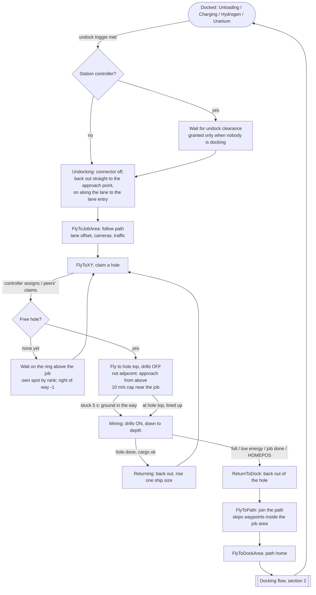
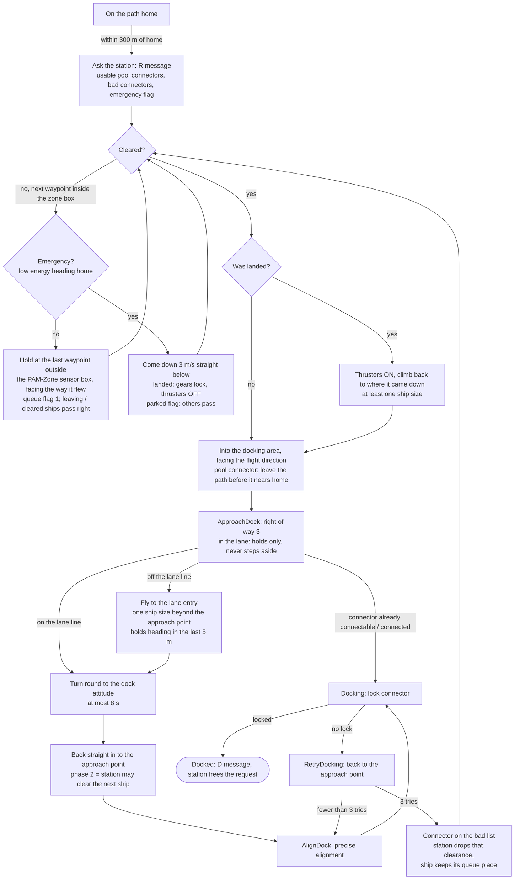
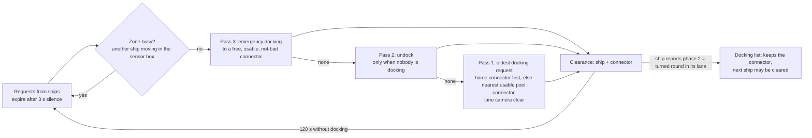
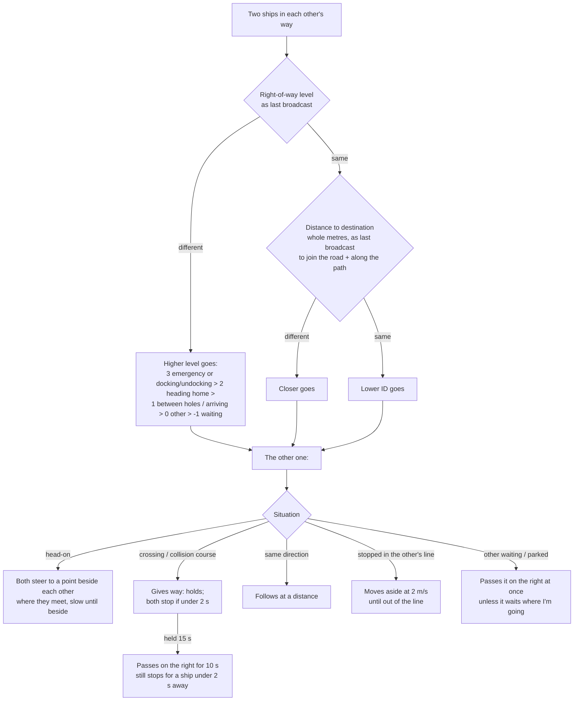

# PAM workflow

How a miner, the station controller and the other ships work together in the current version.
Diagrams are Mermaid (they render on GitHub and in VS Code with a Mermaid preview).

## 1. Miner cycle

## 2. Docking with a station controller

Station side, every run:

## 3. Right of way between ships

The controller sees every ship and predicts conflicts with the same order (for two ships going
the same way, the one catching up gives way). It sends speed limits to the ship that should give
way. Its decision for a pair is kept while the conflict lasts, unless one of the two changes level.
Cameras run all the time in free flight. They brake for anything in the way: other PAM ships only
when right ahead within one ship size, plus PAM ships parked at connectors.
